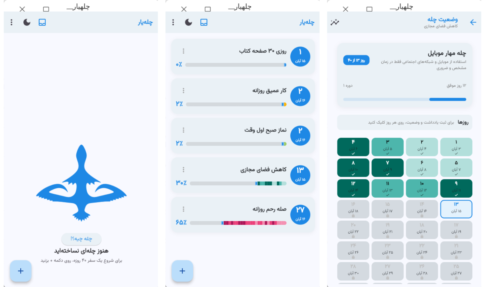
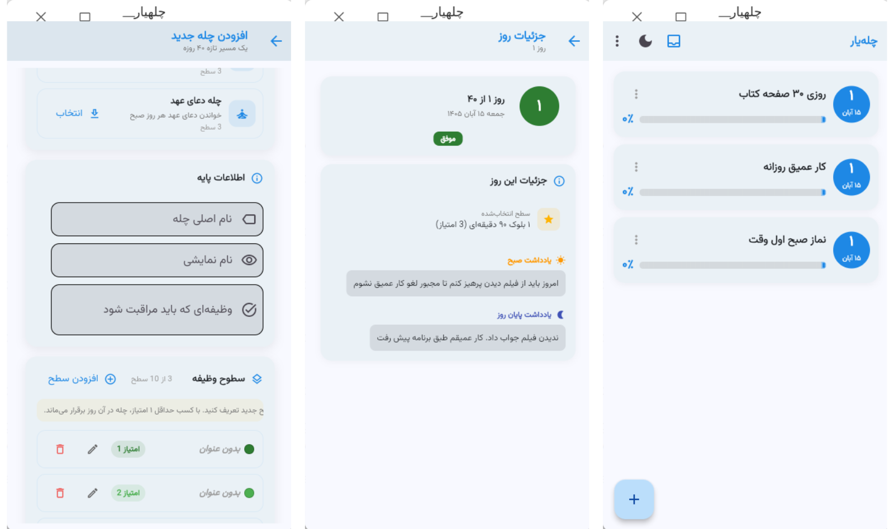
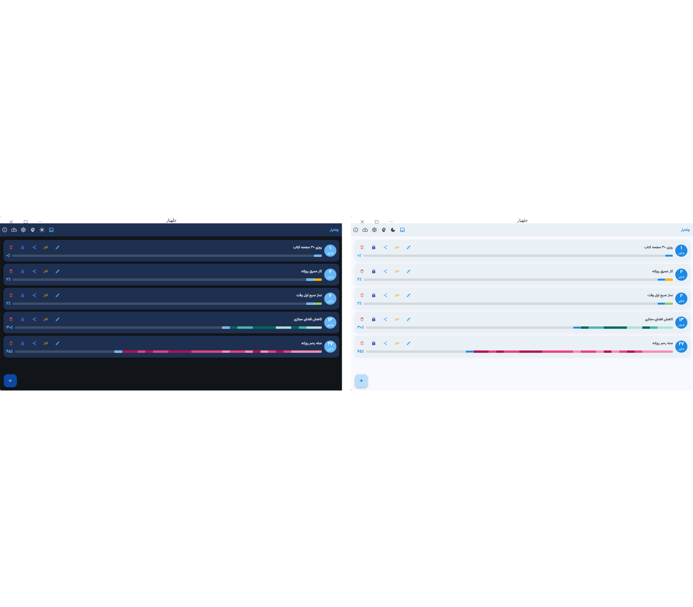

# Chellehyar

## **چله یار**

برنامه ای برای مدیریت چله های تغییر عادت

**توضیح بیشتر:**
شما ۴۰ روز رفتار خود را پایش خواهید کرد تا که مغز شما بپذیرد رفتار مورد نظر برای شما دیگر ضروری نیست و رد های عصبی آن را از مغز شما حذف کند. یا برعکس آن. می توانید بر انجام دادن یک رفتار در این چهل روز نظارت کنید و به مغز خود نشان دهید این عمل برای شما حیاتی هست. در نتیجه مغز شما برای آن کار جدید رد های عصبی جدید خواهد ساخت.

**ویژگی ها:**
- ساخت چله برای تغییر عادت
- اختصاص نام نمایشی برای چله جهت مخفی ماندن موضوع چله
- قفل کردن یک چله
- ساخت سطوح وظیفه ای با امتیاز بندی و رنگ بندی متفاوت برای چله
- نمایش وضعیت یک چله
- امکان ارسال یک چله برای دیگران
- امکان دریافت چله از دیگران
- درج یادداشت صبحگاهی و پایانی در هنگام شب برای یک چله
- نمایش آمار یک چله
- استفاده از تقویم فارسی
- پشتیبان گیری از چله ها
- راهنمای علمی برنامه
- انتخاب تصویر پس زمینه
- انتخاب قلم برای محیط برنامه
- نمایش تاریخجه یک دوره
- تم تاریک و روشن

### محیط برنامه

### پیش نیاز ها:

    flet>=1.0.3, flet-charts, persiantools, cryptography, pillow, jdatetime, tinydb>=4.9.0,

### اجرای کد ها در لینوکس

ابتدا وارد پوشه برنامه شده و یک ترمینال باز کنید و سپس دستور زیر را اجرا کنید

    pip3 install flet
اجرای برنامه:

    flet run

### اجرا روی آندروید
فایل های apk آماده نصب و به کاربستن هستند.

### ساخت فایل IOS
برای ساخت فایل سکوی آی او اس می توانید دستور زیر را اجرا کنید

    flet build ipa

### اجرا روی ویندوز
روی ویندوز آزمایش نشده. اما احتمال ۹۰ درصد مشکلی نخواهد داشت

## مجوز

این نرم‌افزار تحت مجوز GNU عمومی همگانی نسخهٔ ۳ یا نسخه‌های بعدی
(GPL-3.0-or-later) منتشر می‌شود.

حق تکثیر © ۲۰۲۵ [نام شما یا سازمان]

این یک نرم‌افزار آزاد است و با هدف باقی‌ماندن آزاد برای همیشه منتشر
شده است: هر کسی می‌تواند آن را برای هر منظوری استفاده کند، کد منبع
را مطالعه و تغییر دهد، و کپی‌ها را — از جمله به‌صورت رایگان — بازتوزیع
کند، به شرط آنکه نسخه‌های ویرایش‌شده نیز تحت همین مجوز و همراه کد
منبع کامل منتشر شوند.

هیچ‌کس نمی‌تواند این نرم‌افزار را به نرم‌افزار خصوصی تبدیل کند یا
دسترسی آزاد دیگران به کد را محدود سازد.

این برنامه بدون هیچ گارانتی‌ای ارائه می‌شود. متن کامل شرایط در
فایل LICENSE و در آدرس زیر موجود است:
https://www.gnu.org/licenses/gpl-3.0.txt

